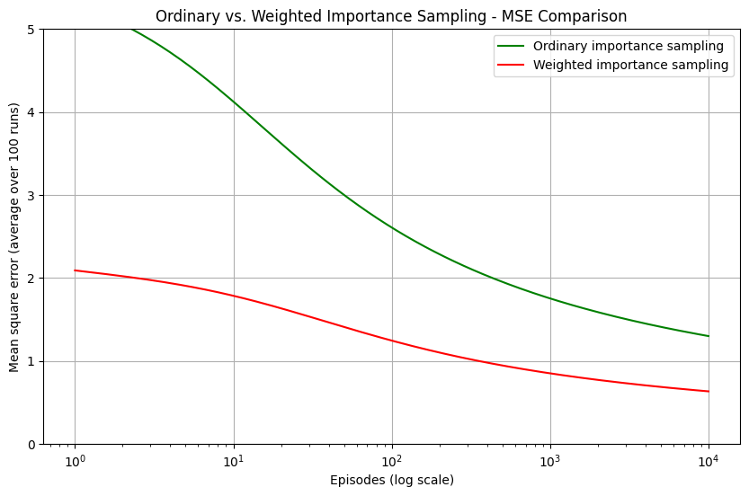
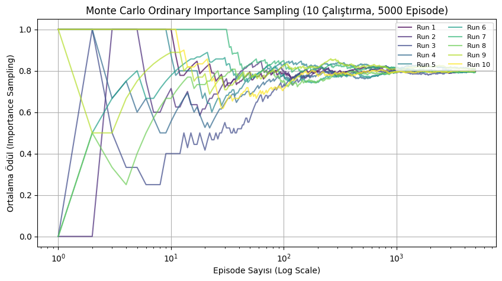

# Performance Evaluation of Monte Carlo Methods in Off-Policy Reinforcement Learning

**Monte Carlo önem örnekleme yöntemleri üzerine mevcut bildirinin ham kod ve belge arşivi.**

Bu depo kaynak Drive klasöründeki notebook ve bildiri dosyalarını bir araya getirir. Yeni bir deney, yeni algoritma uygulaması, yeni sonuç tablosu veya yeniden hesaplanmış grafik içermez. Bildiri metinleri ve notebook dosyaları indirilen kopyalarıyla byte düzeyinde aynıdır; hücreler, kayıtlı çıktılar ve sonuçlar değiştirilmemiştir.

## Özet

| Başlık | Kaynak çalışmanın kapsamı |
|---|---|
| Konu | Politika dışı pekiştirmeli öğrenmede Monte Carlo önem örnekleme yöntemleri |
| Ele alınan yöntemler | Ordinary Importance Sampling (OIS), Weighted Importance Sampling (WIS), Per-Decision Importance Sampling (PDIS) |
| Kaynaklar | Üç notebook, PDF ve DOCX bildiri sürümleri, materyal-metot ve süreç raporu |
| Ortam | Python/Jupyter; NumPy, pandas, Matplotlib ve SciPy |
| Bildiri | [Kaynak PDF](paper/3.bildiri_monte_carlo.pdf), [kaynak DOCX](paper/Desteklemeli_Ogrenme_03.docx) |
| Depo durumu | Mevcut çalışmanın arşivi; bildirinin bütün deneysel iddialarının doğrulandığı anlamına gelmez |

## Çalışmanın yapısı

Notebook hücreleri örnek veri üretimi, grafik çizimi ve bir ödül simülasyonu içerir. Ayrı bir eğitilmiş model, uygulama servisi veya kontrol sistemi bulunmaz. Bildirideki yöntem anlatımı için PDF'nin Material and Methods bölümüne bakın.

## Kaynak görseller ve sonuçlar

Aşağıdaki görseller notebook'ların **mevcut kayıtlı çıktılarından** alınmıştır; yeniden çizilmemiş veya yeni deneyle değiştirilmemiştir.



*Kaynak: notebooks/grafik2.ipynb, sıfırdan sayıldığında 0. hücre. OIS/WIS karşılaştırması görünümündeki bu görsel, elle tanımlanan eğrilerden oluşan çizim örneğidir; ölçülmüş algoritma performansı olarak doğrulanmamıştır.*



*Kaynak: notebooks/veri2.ipynb, sıfırdan sayıldığında 4. hücre. Kaynakta OIS başlığı kullanılmıştır; hücredeki toplam ağırlıklı ödül / toplam ağırlık hesabı WIS biçimindedir. Başlık ve çıktı aslıyla korunmuştur.*

Bildiride 50.000 bölüm ve yöntemlerin performansına ilişkin sonuçlar anlatılır. Bu pakette bu sonuçlar yeniden hesaplanmadı. İncelenen son ödül simülasyonu hücresi 5000 bölüm kullanır. Notebook'ların önemli bir kısmı yöntemleri çalıştırmak yerine örnek eğriler/rastgele tahminler üretir. Bu nedenle mevcut dosyaları saklamak, bildirideki sayısal iddiaların kodla doğrulandığını göstermez. Ayrıntılı tarihsel sonuçlar değiştirilmeden [kaynak PDF'de](paper/3.bildiri_monte_carlo.pdf) bulunur.

## Kurulum

Python 3 ve Jupyter kullanılır. Özgün çalışma ortamının tam paket sürümleri kaynakta sabitlenmemiştir; requirements.txt yalnızca notebook'lardaki mevcut importlara göre hazırlanmıştır. Birebir ortam ve aynı grafik çıktısı garantisi verilmez. GPU gerektiren bir kod görülmemiştir.

ZIP'i açın, README'nin bulunduğu klasörde terminal açın:

```bash
python -m venv .venv
```

Windows PowerShell:

```powershell
.\.venv\Scripts\Activate.ps1
```

macOS/Linux:

```bash
source .venv/bin/activate
```

Ardından:

```bash
python -m pip install -r requirements.txt
python -m jupyter notebook
```

Beklenen: Jupyter arayüzü açılır. `notebooks/` klasöründen dosyayı seçebilirsiniz. Mevcut sonuçları görmek için hücreleri çalıştırmanız gerekmez.

## Kullanım ve sonuçlara erişim

| Dosya | İçerik / açma komutu |
|---|---|
| grafik2.ipynb | Örnek OIS/WIS çizimleri: `python -m jupyter notebook notebooks/grafik2.ipynb` |
| veri.ipynb | Örnek veriler/tahminler ve karşılaştırma çizimleri: `python -m jupyter notebook notebooks/veri.ipynb` |
| veri2.ipynb | Örnek karşılaştırma çizimleri ve son hücrede ödül simülasyonu: `python -m jupyter notebook notebooks/veri2.ipynb` |

Notebook'ta ilgili hücreyi seçip Shift+Enter ile çalıştırabilirsiniz. Rastgelelik tüm hücrelerde sabitlenmediği için yeniden çalıştırmada farklı değerler/görseller oluşabilir. Bu komutlar bildirideki tüm şekil ve sonuçların birebir yeniden üretildiği iddiasını taşımaz. Kayıtlı görseller için notebook'u çalıştırmadan açın.

## Proje yapısı

| Yol | İçerik |
|---|---|
| notebooks/ | Üç özgün notebook; kod ve kayıtlı çıktıları korunmuştur |
| paper/ | Özgün PDF, tam metin DOCX, materyal-metot ve süreç raporu |
| assets/ | Notebook çıktılarından doğrudan alınan kaynak görseller |
| docs/GITHUB_YUKLEME.md | Yükleme ve eski paketten geçiş rehberi |
| docs/PAKET_ACIKLAMASI.md | Hangi dosyanın korunduğu, hangi yeni deneylerin çıkarıldığı |
| docs/DOSYA_KAYITLARI.json | Korunan özgün dosyaların SHA-256 kayıtları |
| requirements.txt | Notebook importlarına dayanan kurulum listesi |

## Atıf, lisans ve iletişim

Çalışma başlığı: *Performance Evaluation of Monte Carlo Methods in Off-Policy Reinforcement Learning*. Tam yazar sırası, DOI, etkinlik ve lisans bilgileri bu pakette doğrulanmış bir yayın künyesi olarak eklenmemiştir. Kaynak süreç raporunda Nil Feyza Özdemir ve Nihle Nur Bozkurt isimleri geçer; bu makalenin eksiksiz yazar listesi olarak sunulmaz.

Açık bir kaynak lisansı tespit edilmediği için kullanıcı adına yazılım lisansı seçilmedi. İletişim için depo sahibiyle GitHub üzerinden iletişime geçilebilir.
